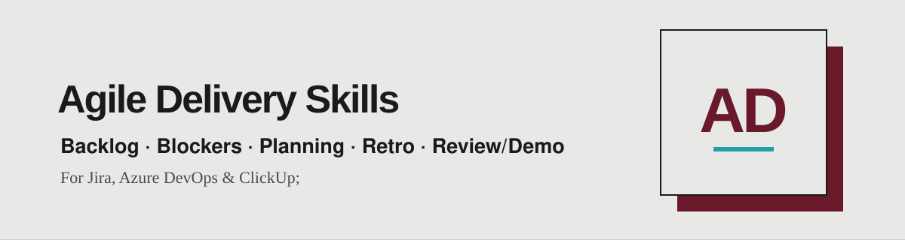

<div align="center">

[English](README.md) · [Português](README.pt.md) · **🌐 Español**



*Cinco skills de agile delivery para equipos Scrum y Kanban que convierten los datos de tu tablero en un briefing listo para usar: preparación del backlog, bloqueos, planificación, retros y reviews.*

<a href="https://www.linkedin.com/in/matheusmello00/"></a>
<a href="mailto:m.mello00@outlook.com"></a>
<a href="https://wa.me/351920102358"></a>


</div>

---

## 🧭 Empieza por el trabajo que tienes entre manos

| Etapa | Trae esto | Usa esta skill | Pide esto |
|---|---|---|---|
| **Scrum:** refinamiento, en los días previos al planning, cuando el tope debe estar listo para entrar al sprint.<br>**Kanban:** reposición de la cola, antes de tirar ítems al flujo. | El tope de tu backlog | `backlog-ready-check` | Verifica si los 20 primeros ítems están listos para el próximo sprint según nuestra Definition of Ready. |
| **Scrum:** ejecución del sprint, en la daily y en checkpoints, siempre que haya ítems detenidos.<br>**Kanban:** revisión del tablero, para ver el impacto de los bloqueos en el WIP y la cola. | Un tablero con ítems bloqueados | `blocker-aging` | Muestra qué está bloqueado, durante cuántos días hábiles y qué escalar. |
| **Scrum:** pre-planning, antes del Sprint Planning, para llegar con alcance y meta propuestos.<br>**Kanban:** no aplica (sin sprint ni compromiso de alcance). | El próximo sprint y la capacidad del equipo | `planning-preparation` | Cruza capacidad con velocity, propone el alcance candidato y redacta un borrador de sprint goal. |
| **Scrum:** pre-retrospectiva, al cerrar el sprint, antes de reunir al equipo.<br>**Kanban:** retro periódica, sobre una ventana de flujo (lead time, throughput, WIP). | Una retrospectiva próxima | `retro-preparation` | Prepara una retro basada en hechos: métricas, dos o tres temas candidatos y un formato adecuado. |
| **Scrum:** pre-review/demo, al final del sprint, antes de presentar a los stakeholders.<br>**Kanban:** fin de una ventana de tiempo (semana, mes), antes de la demo de entregas. | Un sprint terminado | `review-demo-preparation` | Arma el briefing de review/demo agrupado por valor, con narrativa y presentadores. |

> **Scrum o Kanban:** las skills funcionan con ambos modelos y preguntan cuál usas cuando el contexto no lo aclara. La excepción es `planning-preparation`, que depende de sprints, capacidad y velocity, por lo que es solo para Scrum. En Kanban, las estimaciones son opcionales por defecto.

El asistente lee lo que le proporcionas, hace hasta cuatro preguntas si falta contexto y trabaja hacia el entregable. Indícale tablero o proyecto, sprint, equipo, objetivo y restricciones cuando puedas. Las skills son de solo lectura por defecto: informan, nunca modifican tu tracker.

## 🧱 Cómo se construye cada skill (estándar Agent Skills)

Todas las skills siguen la [especificación abierta Agent Skills](https://agentskills.io/specification), por lo que funcionan en cualquier asistente compatible.

```
nombre-de-la-skill/
├── SKILL.md          # Obligatorio: frontmatter + instrucciones (menos de 500 líneas)
├── references/       # Opcional: detalle cargado solo cuando hace falta, un nivel de profundidad
├── scripts/          # Opcional: código autocontenido, con --help y errores claros
├── assets/           # Opcional: plantillas y recursos estáticos
└── evals/            # Extensión nuestra: queries de descubrimiento y escenarios de calidad
```

## 🔌 Funciona con

Jira (Atlassian), Azure DevOps y ClickUp, mediante el conector de tracker (MCP) que tu asistente ya tiene. Cada skill incluye un `references/trackers.md` con el mapeo de consultas y campos. Responde en el idioma en que escribas. Los scripts incluidos usan Python 3.9+ con solo la biblioteca estándar.

> **Azure DevOps y ClickUp:** para funcionar bien fuera de Jira, añade los campos propios de la herramienta a la búsqueda (tipos y estados de los ítems, campo de estimación, marcador de bloqueo, sprint/iteración, criterios de aceptación) o indica sus nombres a la skill. Sin ellos la búsqueda puede perder ítems.

## 📦 Instalación

### Plugin de Claude Code

Ejecuta estos comandos dentro de Claude Code:

```text
/plugin marketplace add matheusmello00/Agile-Delivery-Skills
/plugin install agile-delivery@agile-delivery
```

Luego invoca una skill por el nombre del plugin:

```text
/agile-delivery:blocker-aging
Muéstrame qué está bloqueado en el tablero Checkout y qué debería escalarse.
```

El plugin contiene las 5 skills en `skills/`. No necesita API key ni servicio externo para leer sus instrucciones; tu asistente aporta el modelo y el conector de tracker.

### Codex o Cursor

Clona el repositorio y copia una skill a tu directorio personal de skills:

```bash
git clone https://github.com/matheusmello00/Agile-Delivery-Skills.git
mkdir -p ~/.agents/skills
cp -R Agile-Delivery-Skills/skills/blocker-aging ~/.agents/skills/
```

Para instalar las 5, reemplaza el último comando por:

```bash
cp -R Agile-Delivery-Skills/skills/* ~/.agents/skills/
```

Revisa si ya existen carpetas con el mismo nombre antes de copiar; copiar puede sobrescribir archivos. Para uso en equipo, copia en `.agents/skills/` dentro de tu proyecto. En Codex, invoca `$blocker-aging`; en Cursor, usa `/blocker-aging` o describe la tarea para que el asistente elija la skill.

### Claude Code sin el plugin

Tras clonar, usa `~/.claude/skills/` para skills personales o `.claude/skills/` para skills de proyecto:

```bash
mkdir -p ~/.claude/skills
cp -R Agile-Delivery-Skills/skills/blocker-aging ~/.claude/skills/
```

Invoca `/blocker-aging`. Elige el plugin o el método de copia, no ambos, para evitar instalaciones duplicadas.

### Otros asistentes, incluido ChatGPT

Abre el `SKILL.md` correspondiente y entrégaselo junto con tu trabajo. Incluye los archivos de `references/` de esa skill (y `scripts/` si puedes ejecutar Python) para tener todo el material de apoyo. El descubrimiento automático depende del asistente; clonar este repositorio no instala las skills en todos los productos.

## 👤 Autor

Creado por [Matheus Mello](https://github.com/matheusmello00) — Senior Product Manager & Agile Coach.
