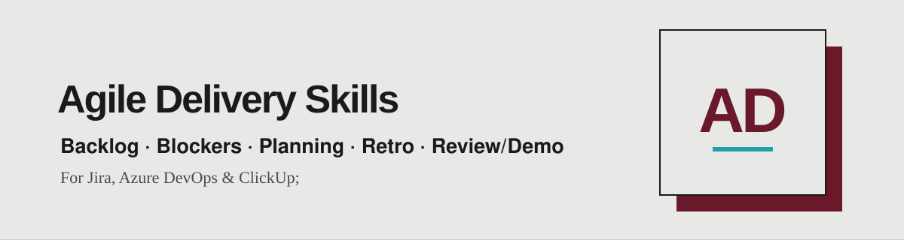

<div align="center">

**🌐 English** · [Português](README.pt.md) · [Español](README.es.md)



*Five agile delivery skills that turn your board data into a ready-to-use briefing: backlog readiness, blockers, planning, retros and reviews.*

<a href="https://www.linkedin.com/in/matheusmello00/"></a>
<a href="mailto:m.mello00@outlook.com"></a>
<a href="https://wa.me/351920102358"></a>


</div>

---

## 🧭 Start with the work in front of you

| Bring this | Use this | Ask for this |
|---|---|---|
| The top of your backlog | `backlog-ready-check` | Check whether the top 20 items are ready for the next sprint against our Definition of Ready. |
| A board with blocked items | `blocker-aging` | Show what is blocked, for how many business days, and what to escalate. |
| The next sprint and team capacity | `planning-preparation` | Cross capacity with velocity, propose the candidate scope and draft a sprint goal. |
| An upcoming retrospective | `retro-preparation` | Prepare a facts-based retro: metrics, two or three candidate themes and a suitable format. |
| A finished sprint | `review-demo-preparation` | Build the review/demo briefing grouped by value, with a narrative and presenters. |

The assistant reads what you provide, asks up to four questions for missing context, and works toward the deliverable. Give it your board or project, sprint, team, goal and constraints when you can. The skills are read-only by default: they report, they never change your tracker.

## 🔌 Works with

Jira (Atlassian), Azure DevOps and ClickUp, through the tracker connector (MCP) your assistant already has. Each skill ships a `references/trackers.md` with the query and field mapping. Replies come in the language you write in. Bundled scripts use Python 3.9+ with the standard library only.

## 📦 Install

### Claude Code plugin

Run these commands inside Claude Code:

```text
/plugin marketplace add matheusmello00/Agile-Delivery-Skills
/plugin install agile-delivery@agile-delivery
```

Then invoke a skill by its plugin name:

```text
/agile-delivery:blocker-aging
Show me what is blocked on the Checkout board and what should be escalated.
```

The plugin contains the 5 skills under `skills/`. It needs no API key or external service to read its instructions; your assistant supplies the model and the tracker connector.

### Codex or Cursor

Clone the repository, then copy one skill into your personal skills directory:

```bash
git clone https://github.com/matheusmello00/Agile-Delivery-Skills.git
mkdir -p ~/.agents/skills
cp -R Agile-Delivery-Skills/skills/blocker-aging ~/.agents/skills/
```

To install all 5, replace the final command with:

```bash
cp -R Agile-Delivery-Skills/skills/* ~/.agents/skills/
```

Check for existing folders with the same names before copying; copying can overwrite files. For team use, copy into `.agents/skills/` in your project instead. In Codex, invoke `$blocker-aging`; in Cursor, use `/blocker-aging` or describe the task so the assistant can select the skill.

### Claude Code without the plugin

After cloning, use `~/.claude/skills/` for personal skills or `.claude/skills/` for project skills:

```bash
mkdir -p ~/.claude/skills
cp -R Agile-Delivery-Skills/skills/blocker-aging ~/.claude/skills/
```

Invoke `/blocker-aging`. Choose either the plugin or the copy method to avoid duplicate installations.

### Other assistants, including ChatGPT

Open the relevant `SKILL.md` and provide it with your work. Include that skill's `references/` files (and `scripts/` if you can run Python) for the full supporting material. Automatic discovery depends on the assistant; cloning this repository does not install the skills into every product.

## 👤 Author

Built by [Matheus Mello](https://github.com/matheusmello00) — Senior Product Manager & Agile Coach.
