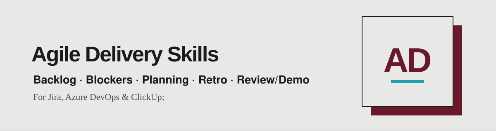

<div align="center">

[English](README.md) · **🌐 Português** · [Español](README.es.md)



*Cinco skills de agile delivery para times Scrum e Kanban que transformam os dados do seu board num briefing pronto a usar: prontidão do backlog, bloqueios, planning, retros e reviews.*

<a href="https://www.linkedin.com/in/matheusmello00/"></a>
<a href="mailto:m.mello00@outlook.com"></a>
<a href="https://wa.me/351920102358"></a>


</div>

---

## 🧭 Comece pelo trabalho que você tem em mãos

| Etapa | Traga isto | Use esta skill | Peça isto |
|---|---|---|---|
| **Scrum:** refinamento, nos dias antes do planning, quando o topo precisa estar pronto para entrar na sprint.<br>**Kanban:** reposição da fila, antes de puxar itens para o fluxo. | O topo do seu backlog | `backlog-ready-check` | Verifique se os 20 primeiros itens estão prontos para a próxima sprint segundo a nossa Definition of Ready. |
| **Scrum:** execução da sprint, na daily e em checkpoints, sempre que houver itens parados.<br>**Kanban:** revisão do board, para ver o impacto dos bloqueios no WIP e na fila. | Um board com itens bloqueados | `blocker-aging` | Mostre o que está bloqueado, há quantos dias úteis e o que escalar. |
| **Scrum:** pré-planning, antes do Sprint Planning, para chegar à cerimônia com escopo e meta propostos.<br>**Kanban:** não se aplica (sem sprint nem compromisso de escopo). | A próxima sprint e a capacidade do time | `planning-preparation` | Cruze capacidade com velocity, proponha o escopo candidato e rascunhe um sprint goal. |
| **Scrum:** pré-retrospectiva, ao fechar a sprint, antes de reunir o time.<br>**Kanban:** retro periódica, sobre uma janela de fluxo (lead time, throughput, WIP). | Uma retrospectiva próxima | `retro-preparation` | Prepare uma retro baseada em fatos: métricas, dois ou três temas candidatos e um formato adequado. |
| **Scrum:** pré-review/demo, no fim da sprint, antes de apresentar aos stakeholders.<br>**Kanban:** fim de uma janela de tempo (semana, mês), antes da demo de entregas. | Uma sprint concluída | `review-demo-preparation` | Monte o briefing de review/demo agrupado por valor, com narrativa e apresentadores. |

> **Scrum ou Kanban:** as skills funcionam nos dois modelos e perguntam qual é o seu quando o contexto não deixa claro. A exceção é `planning-preparation`, que depende de sprint, capacidade e velocity e por isso serve só para Scrum. No Kanban, as estimativas são opcionais por padrão.

O assistente lê o que você fornece, faz até quatro perguntas se faltar contexto e trabalha em direção ao entregável. Informe board ou projeto, sprint, time, objetivo e restrições sempre que puder. As skills são somente leitura por padrão: reportam, nunca alteram o seu tracker.

## 🔌 Funciona com

Jira (Atlassian), Azure DevOps e ClickUp, pelo conector de tracker (MCP) que o seu assistente já tem. Cada skill traz um `references/trackers.md` com o mapeamento de consultas e campos. As respostas vêm no idioma em que você escrever. Os scripts incluídos usam Python 3.9+ apenas com a biblioteca padrão.

> **Azure DevOps e ClickUp:** para funcionar bem fora do Jira, adicione os campos da própria ferramenta à busca (tipos e estados dos itens, campo de estimativa, marcador de bloqueio, sprint/iteração, critérios de aceite) ou informe os nomes à skill. Sem eles a busca pode perder itens.

## 📦 Instalação

### Plugin do Claude Code

Execute estes comandos dentro do Claude Code:

```text
/plugin marketplace add matheusmello00/Agile-Delivery-Skills
/plugin install agile-delivery@agile-delivery
```

Depois invoque uma skill pelo nome do plugin:

```text
/agile-delivery:blocker-aging
Mostre o que está bloqueado no board Checkout e o que deve ser escalado.
```

O plugin contém as 5 skills em `skills/`. Não precisa de API key nem de serviço externo para ler as instruções; o seu assistente fornece o modelo e o conector de tracker.

### Codex ou Cursor

Clone o repositório e copie uma skill para o seu diretório pessoal de skills:

```bash
git clone https://github.com/matheusmello00/Agile-Delivery-Skills.git
mkdir -p ~/.agents/skills
cp -R Agile-Delivery-Skills/skills/blocker-aging ~/.agents/skills/
```

Para instalar as 5, troque o último comando por:

```bash
cp -R Agile-Delivery-Skills/skills/* ~/.agents/skills/
```

Verifique se já existem pastas com o mesmo nome antes de copiar; copiar pode sobrescrever arquivos. Para uso em equipe, copie para `.agents/skills/` dentro do projeto. No Codex, invoque `$blocker-aging`; no Cursor, use `/blocker-aging` ou descreva a tarefa para o assistente escolher a skill.

### Claude Code sem o plugin

Depois de clonar, use `~/.claude/skills/` para skills pessoais ou `.claude/skills/` para skills de projeto:

```bash
mkdir -p ~/.claude/skills
cp -R Agile-Delivery-Skills/skills/blocker-aging ~/.claude/skills/
```

Invoque `/blocker-aging`. Escolha o plugin ou o método de cópia, não ambos, para evitar instalações duplicadas.

### Outros assistentes, incluindo o ChatGPT

Abra o `SKILL.md` correspondente e forneça-o junto com o seu trabalho. Inclua os arquivos de `references/` dessa skill (e `scripts/` se puder executar Python) para ter todo o material de apoio. A descoberta automática depende do assistente; clonar este repositório não instala as skills em todos os produtos.

## 👤 Autor

Criado por [Matheus Mello](https://github.com/matheusmello00) — Senior Product Manager & Agile Coach.
